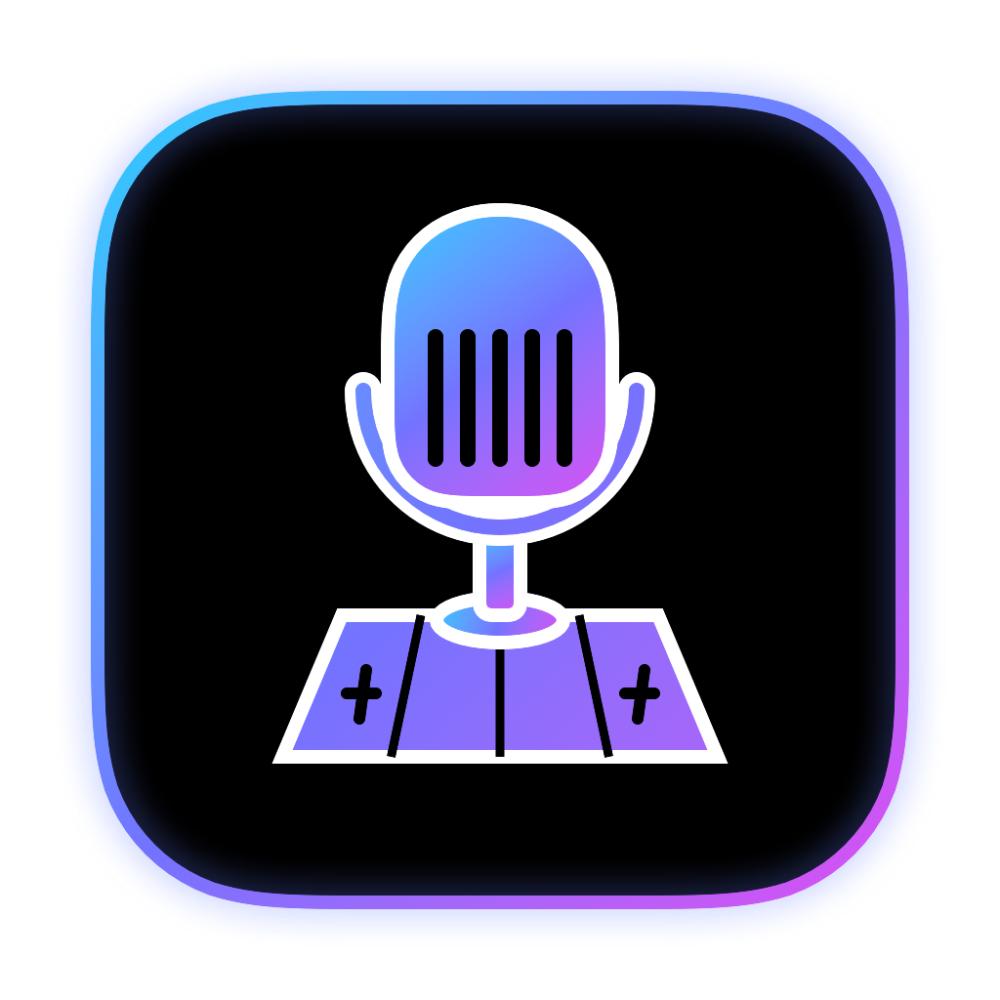

<h1 align="center">MicDeck</h1>

Open-source control software for USB mics that have no native macOS app. First target: HyperX DuoCast.

## What it does
- Lights for the HyperX DuoCast: effects, colors, brightness.
- Mute indicator that follows the mic's physical mute button.
- **Meeting mode:** cleans up the mic (background noise, typing, clicks) for any meeting app.

## Requirements
- A Mac with Apple Silicon.
- **Meeting mode needs BlackHole 2ch**, a free virtual audio device made by Existential Audio. It is a separate app by another developer: MicDeck does not include it, install it, or maintain it. Read what it is first: [website](https://existential.audio/blackhole/), [source code and license](https://github.com/ExistentialAudio/BlackHole), then install it yourself only if you want Meeting mode. macOS only lets an audio driver, not an app, create a new microphone, and BlackHole is that driver. Install it from its website, or with `brew install blackhole-2ch`, then in your meeting app choose **BlackHole 2ch** as the microphone.
- **Without BlackHole, MicDeck still works**: lights and the mute indicator are unaffected. Only Meeting mode is turned off (its switch is greyed out in the app). In your meeting app you then pick the normal mic.

Status: early development. Not affiliated with HyperX or HP.

License: GPL-3.0-only.
